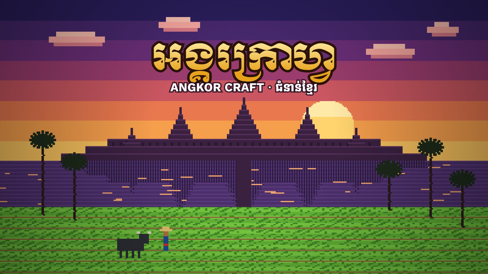

# អង្គរក្រាហ្វ · Angkor Craft

**ហ្គេមសាងសង់ និងរស់រានមានជីវិត ជំនាន់ខ្មែរ** — a Khmer-language, Angkor-themed block-building survival game that runs entirely in the browser. It is written in plain JavaScript and [three.js](https://threejs.org/), with no build step and no install. Every texture and sound is generated in code.



## Play

**Locally:** from the project folder run a tiny web server, then open the address it prints:

```bash
python3 -m http.server 8000 --bind 0.0.0.0
```

Open `http://<your-ip>:8000` (macOS: `ipconfig getifaddr en0`; Windows: `ipconfig`; Linux: `hostname -I`) so other devices on the same Wi-Fi can join too. Opening `index.html` directly also works in most browsers.

> Use a desktop browser (Chrome, Edge, Firefox or Safari) with a mouse and keyboard. The game loads three.js, PeerJS and the Khmer fonts from a CDN, so it needs an internet connection.

## Controls

| Key | Action |
| --- | --- |
| `W` `A` `S` `D` | Move |
| `Space` | Jump / swim up |
| `Shift` | Sprint |
| Mouse | Look around |
| Left click (hold) | Mine a block / attack |
| Right click | Place a block, eat (hold), open a door, open a Crafting Table or Furnace, sleep in a bed, trade with a villager, till with a hoe, plant seeds, use bone meal, feed animals, use an Eye of Ender |
| `E` | Inventory and 2x2 crafting |
| Inventory: drag and drop | Left button only. Press on a stack, drag it to a slot and release to drop it all there. Hold and sweep across several slots to split it evenly. Right-click does nothing in the inventory |
| `1`-`9` / scroll | Select hotbar slot |
| `Q` | Drop an item (`Ctrl+Q`: the whole stack) |
| `R` | Cycle armor tier |
| `F5` / `V` | Camera view: first person, third person behind, third person in front |
| `F3` | Coordinates, facing direction, debug info |
| `T` / `Enter` | Chat and commands |
| `Esc` | Pause |

### Chat commands

Press `T`, then type a command:

| Command | What it does |
| --- | --- |
| `/locate` | Prints the stronghold coordinates (`/locate village` finds the nearest village) |
| `/camera first` / `back` / `front` | Picks the camera view |
| `/gamemode creative` / `survival` | Switches game mode |
| `/invite` | Prints the room code and invite link while hosting |
| `/give <item> [n]` | Gives items, for example `/give diamond 12` or `/give eye_of_ender 9` |
| `/tp end` / `patala` / `stronghold` / `village` / `home` / `x y z` | Teleports you |
| `/summon <creature>` | Calls a creature in front of you, for example `/summon elephant` or `/summon reahu` |
| `/time set day` / `night` | Sets the time of day |

## The Khmer edition

- **Everything in Khmer:** menus, item names, tooltips, toasts, chat and death messages, with Khmer digits and the Kantumruy Pro and Moul fonts.
- **A Cambodian world:** red laterite earth, sandstone and carved temple stone, clay roof tiles, lotus ponds, rice fields with eight growth stages, sugar palms, coconut palms and two-block banana plants, each with its own fruit, drink and dessert (palm sugar, num ansom chek, num kom).
- **Khmer crafts and tools:** krama scarves, av pak shirts, paper lanterns and oil lamps, a lacquered-handle dav (sword), a bronze lompeng spear, the Preah Khan swords, a Pailin sapphire sword and a golden mkot crown. Ores include bronze, gold and Pailin sapphire.
- **Khmer creatures:** Yeak (forest giants), Preay (ghosts), tigers in the forest, a laterite exploding spirit, black village pigs and Khmer villagers in krama and palm-leaf hats.
- **More of the world (Khmer versions of the standard block-game content):**
  - Building: Preah Ko bricks, river clay, mossy cobblestone, sandstone and stone stairs, a laterite wall, fence gates, trapdoors, bamboo ladders, signs, storage blocks of gold, iron, bronze, diamond and sapphire.
  - Farm and kitchen: bamboo by the rivers, pumpkins and watermelons, rice-straw bales, fishing, mangoes, kralan, num sankhya lapov, eggs and milk.
  - Stations: a campfire that grills food, a rain-water jar, a herbal pot for medicine, an anvil that repairs tools, a yantra table with palm-leaf manuscript shelves (a protective blessing), an ox cart to store things.
  - Tools: flint and steel, shears, a fishing rod, a compass, a clock and a map (each shows a small panel while held), the Khmer crossbow, fireworks, rope leads and saddles.
  - Animals: water buffalo (milk them), elephants and horses you can saddle and ride, dogs and cats you can tame, monkeys that steal food, bats.
  - Monsters: crocodiles by the rivers, cobras in the forest, the Ap (a flying ghost head) and the shadow ghost, which drops a naga pearl (throw it to teleport).
  - **Patala (ឋានបាតាល):** build an obsidian frame (inside 2-4 wide, 3-5 tall) and light it with flint and steel to open a naga gate to the naga underworld: lava lakes, ash sand, hanging naga-gem lamps, and Reahu, the eclipse demon, waiting at the central shrine.
  - The final boss of the End is now the seven-headed Naga king, and the village guardian is a Dvarapala with a gada club.

## Textures and the Figma file

All textures are pixel art: the redrawn set lives in `art-data.js`, generated from the scripts in `tools/` (`textures-v2.js` for blocks, tools and faces, `textures-v3-missing.js` for the new content, `textures-v4-existing.js` for the other items, armour and plants). Run `node tools/build-art-data.js` after changing a script. The game draws its older procedural textures first (`createTextureAtlas`, `MobSkins` in `game.js`) and then replaces every tile and face that has a redrawn version. Every texture is also drawn as editable pixel art in Figma, one component per texture, labelled in Khmer:

**[Angkor Craft · Textures (Figma)](https://www.figma.com/design/ZBGJOzRVXnlpmB4L0lcsD6)**

| Page | Contents |
| --- | --- |
| ប្លុក និងរុក្ខជាតិ · Blocks & Plants | 69 block faces, 19 plants and crop stages, 10 block-breaking cracks |
| របស់របរ និងឧបករណ៍ · Items & Tools | 54 items and foods, 41 tools, weapons and armour |
| សត្វ និងបិសាច · Mob Skins | 46 animal, villager and monster skins |

Each texture is drawn at 8x (mob skins at 10-32x) with one vector per colour, so you can recolour or repaint it directly. Every component has two export presets: the game-size PNG (16x16, or the skin's own size) and the large preview.

**Changing a texture in the game:** the redrawn textures near the end of `createTextureAtlas` are 16x16 *pixel maps*. Each character is one pixel, looked up in a small palette, so the code reads like the picture:

```js
drawPixelMap(TILES.STRING, [
    '................',
    '.SS.............',
    's..S............',
    // ...16 rows of 16 characters
], { S: [240, 236, 224], s: [190, 182, 160] });
```

`'.'` is transparent (or the base texture, for ore on stone). Copy the pixels from the Figma component, edit the rows, reload the page.

## Play with friends online

Multiplayer is peer-to-peer (WebRTC through [PeerJS](https://peerjs.com/)), so it works on any static host such as GitHub Pages, Vercel or Cloudflare Workers, with no game server to run.

**Host (you):**
1. Open the deployed site, click **Multiplayer -> Host New Server** (or **Host Local Server** on the title screen).
2. Pick a player name and keep the generated **room code** (or type your own).
3. Click **Start & Host Server**. Once you are in the world, an **invite link** is shown in chat (and copied to your clipboard). `/invite` prints it again, and the room code is shown top-left.
4. Send the code or link to your friends and **keep your tab open**. The host's browser is the hub for the room.

**Friends:**
1. Open the invite link (it fills in the code), or open the site and click **Multiplayer -> Direct Connect**.
2. Enter the room code and a name, then click **Join Server**.

Up to 8 players per room. Everyone sees each other's movement, held item and chat, and every block placed or broken. Friends who join late receive all the changes made so far.

**Good to know:**
- The world terrain is identical for everyone (fixed seed). Mobs, the Ender Dragon and the End are **not** synchronised: each player simulates their own, so fight the dragon on your own screen.
- If the host closes the tab, the room ends. Friends play on the host's seed and see the same blocks. The host's world is saved in the host's browser.
- Room codes are registered on PeerJS's free public signalling server (`0.peerjs.com`). It is fine for friends, but it is best-effort. For something more reliable, run your own [PeerServer](https://github.com/peers/peerjs-server) and set `host`, `port`, `path` and `secure` in `PEER_CONFIG` in `game.js`.
- Most home networks connect directly. Some strict firewalls and mobile networks need a TURN relay, which is not included: add one to `iceServers` in `PEER_CONFIG` if a friend cannot connect.
- **Production or local:** the game detects where it is running. On your deployed site (Cloudflare, Vercel...) the invite link is that site's address. On `localhost` (a dev server or a local copy) the host window says so and the link only works on this computer, so friends elsewhere open your deployed game, click **Multiplayer -> Direct Connect** and type the room code. There is nothing to configure.
- **You stay the same player.** Your browser keeps a permanent player id and name. Quit with **Save & Quit** and the room is saved with its world; later, **Multiplayer** shows it as "Created by you" with a **Host Again** button (typing your own room code into Direct Connect does the same), and you come back as the creator with your inventory and builds. The room is only open to friends while you are hosting.
- **Guests are remembered too.** The host's world keeps each friend's inventory, stats and position by their player id, so a friend who leaves and rejoins the same room gets their things back. If the same account is already in the room (for example you open a second tab), the second one joins as a temporary extra player and is not saved.
- **Friends cannot connect?** Most networks connect directly. Strict firewalls and mobile networks need a relay (TURN). When the game is deployed as a Cloudflare Worker (see [Deploy to Cloudflare](#deploy-to-cloudflare-workers)), add a relay's details to the Worker: a free provider such as Metered Open Relay (`TURN_URLS`, `TURN_USERNAME`, `TURN_CREDENTIAL`) or Cloudflare's own TURN (`TURN_KEY_ID`, `TURN_KEY_API_TOKEN`). `worker/index.js` serves them at `/api/turn`; without them the game simply uses direct connections. Open `https://<your-site>/api/turn` to check: `"status":"ok"` means the relay works.
- **Player names are unique in a room** (upper/lower case ignored). If your name is taken, Direct Connect says so and fills in a free one (for example `Sok2`); click Join again to use it.
- Anyone with the code can join, so share it only with friends.

## Deploy to Cloudflare Workers

This is the recommended host, because it also runs the relay (`/api/turn`) that lets friends on strict networks connect. `wrangler.jsonc` serves the game files as static assets and runs `worker/index.js` for `/api/turn`; `.assetsignore` keeps the README, docs and Worker code off the site.

1. In the Cloudflare dashboard, open **Workers & Pages -> Create -> Import a repository** and pick this GitHub repo. Leave the build command empty and the deploy command as `npx wrangler deploy`.
2. Get relay (TURN) details. Pick one:
   - **Free, no card (recommended):** sign up for [Metered Open Relay](https://www.metered.ca/tools/openrelay/) (20 GB a month free). In its dashboard, copy the TURN server addresses, the username and the password.
   - **Cloudflare Realtime TURN:** create a key under **Realtime -> TURN Server**. Free up to 1,000 GB a month, then billed per GB.
3. In the Worker, open **Settings -> Variables and secrets** and add the variables for the option you chose, then click **Deploy**:

   | Option | Name | Value | Type |
   | --- | --- | --- | --- |
   | Any provider (Metered...) | `TURN_URLS` | the relay addresses, comma-separated, e.g. `turn:global.relay.metered.ca:80,turns:global.relay.metered.ca:443?transport=tcp` | Text |
   | | `TURN_USERNAME` | the relay username | Text |
   | | `TURN_CREDENTIAL` | the relay password | Secret |
   | Cloudflare | `TURN_KEY_ID` | the TURN key's ID | Text |
   | | `TURN_KEY_API_TOKEN` | the TURN key's API token | Secret |

4. Push a commit (or retry the latest deployment), then open `https://<your-worker>.workers.dev/api/turn`:
   - `"status":"ok"`: the relay works.
   - `"status":"not-configured"`: the variables are missing or misspelled.
   - `"status":"cloudflare-error-401"` (or 403/404): the key ID or token is wrong.

To deploy from your computer instead: `npx wrangler deploy`.

## Deploy to GitHub Pages

1. Create a GitHub repository and push these files to the `main` branch:

   ```bash
   git init
   git add .
   git commit -m "Angkor Craft"
   git branch -M main
   git remote add origin https://github.com/<your-github-username>/<repo-name>.git
   git push -u origin main
   ```

2. On GitHub open **Settings -> Pages**.
3. Under **Build and deployment**, set **Source** to **Deploy from a branch**, pick branch **main** and folder **/ (root)**, then save.
4. After a minute or two the site is live at `https://<your-github-username>.github.io/<repo-name>/`. Send that link to your friends.

Any other static host works the same way (Netlify, Vercel): upload the folder and serve `index.html`. These hosts do not run the relay, so friends on strict networks may not be able to connect.

## Project layout

```
index.html        Page structure: title screen, menus, HUD, inventory windows (Khmer)
style.css         Base styling
khmer.css         Khmer typography and Angkor colour theme
game.js           The whole game: world, textures, rendering, mobs, crafting, the End and Patala
art-data.js       The redrawn pixel art (generated by tools/build-art-data.js)
tools/            Texture generators for the redrawn art and the Figma proposals
held-tool.js      First-person hand overlay: tool/sword/bow poses, swing, bow draw, slash effect
held-tool.css     Pose math, swing and enchant-glint keyframes for that overlay
poster.jpg        Loading screen artwork (original Angkor Craft poster)
worker/index.js   Cloudflare Worker: serves the game and the /api/turn relay credentials
wrangler.jsonc    Cloudflare Worker config (.assetsignore lists files not to publish)
docs/             Design notes and roadmap
```

## Tech

- [three.js](https://threejs.org/) r128 and [PeerJS](https://peerjs.com/) 1.5.4, loaded from a CDN
- Plain JavaScript, no bundler
- Web Audio API for generated sound effects
- A canvas-generated 16x16 texture atlas

## Credits

Made by Khemra Tech Consulting. Angkor Craft is an independent, fan-made, educational project inspired by block-building survival games. It is not affiliated with or endorsed by Mojang or Microsoft, and it ships none of their art files: every texture, skin and the poster are drawn for this project.
