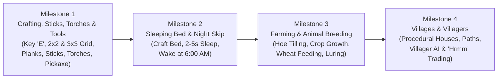

# Minecraft (JavaScript Edition) — Phased Feature Roadmap

This roadmap breaks down the upcoming gameplay systems into focused, sequential milestones so each feature can be built and tested one by one without overwhelming the game loop.

---

## 1. Roadmap Architecture Overview

---

## 2. Milestone Breakdown (One by One)

### 🔨 Milestone 1: Inventory 2×2, Sticks, Torches & Crafting Table ✅ Done
*Focus: Establishing the foundational survival crafting progression.*

1. **Player Inventory Screen (<kbd>E</kbd> Key)**:
   * Pressing <kbd>E</kbd> opens the classic Minecraft inventory window:
     * Full 27-slot inventory storage + 9-slot hotbar.
     * 2×2 Personal Crafting Grid with output slot.
     * 2D animated player avatar preview in the corner.
2. **Wood Refining & Sticks**:
   * 1 Oak Log → 4 Oak Planks.
   * 2 Planks (vertically stacked) → **4 Sticks**.
3. **Torch Crafting & Illumination**:
   * **1 Coal + 1 Stick (vertically stacked)** → **4 Torches**.
   * Placing Torches on the ground or walls emits warm glowing light and subtle flame/smoke particles.
   * Hostile mobs (Creepers, Skeletons, Spiders) cannot spawn within 12 blocks of placed torches.
4. **The Crafting Table**:
   * 4 Planks in a 2×2 grid → **Crafting Table**.
   * Right-clicking the placed Crafting Table opens the full **3×3 Crafting Grid**.
5. **Essential Tool Crafting**:
   * **Wooden & Stone Pickaxes**: 3 Planks/Cobblestone + 2 Sticks → Pickaxe (mines stone & ores much faster).
   * **Wooden & Stone Swords**: 2 Planks/Cobblestone + 1 Stick → Sword (high attack damage against mobs).
   * **Axes & Shovels**: Rapid harvesting of wood and dirt.

---

### 🛏️ Milestone 2: Sleeping Bed & Night Skipping ✅ Done

**What was built** (`game.js`, search for `BEDS`):
* **Sheep** spawn with other animals, drop 1-2 **White Wool**, and breed with wheat.
* **Bed**: 3 Wool over 3 Planks at a Crafting Table. Placed as two low blocks (red blanket, white pillow at the head) in the direction you face; breaking either half removes both and drops one bed.
* Right-click a bed to set your **respawn point** (death and `/tp home` take you there while the bed exists). At night (18:30-5:30) you fall asleep: the screen fades, and you wake at 6:00 AM to birdsong. Monsters within 8 blocks prevent sleeping.
* In multiplayer, one player sleeping makes it morning for the whole room (simpler than Minecraft, which needs everyone in bed).

**Original plan:**
*Focus: Nighttime shelter and time control.*

1. **Bed Crafting & Placement**:
   * Recipe: 3 Wool + 3 Wood Planks in the Crafting Table.
   * 2-block long voxel bed with red blanket and white pillow.
2. **Sleeping Mechanic**:
   * Right-clicking the bed at night (≥ 18:00 or dark conditions) puts the player into bed.
   * Player camera tilts back onto the pillow with a soothing sleep overlay:
     * "Sleeping... Skipping the night (2–5 seconds)".
   * If hostile monsters are within 8 blocks: displays notice "You may not rest now, there are monsters nearby".
3. **Sunrise Skip**:
   * In-game clock accelerates smoothly directly to **6:00 AM (Sunrise)**.
   * Player wakes up refreshed, with morning birdsong and skeletons catching fire outside.

---

### 🌾 Milestone 3: Farming, Planting & Animal Husbandry ✅ Done

**What was built** (`game.js`, search for `FARMING`):
* Wooden, Stone and Diamond **Hoes** (2 material + 2 sticks). Right-click dirt or grass to make **Farmland**; it turns moist (darker) with water within 4 blocks.
* **Wheat Seeds** drop from tall grass (1 in 8) and from ripe wheat. Plant them on farmland; wheat grows through 8 stages near the player (about twice as fast on moist farmland). Only the host grows crops in multiplayer, and the changes are shared.
* **Bone Meal** (1 Bone → 3; skeletons drop bones) grows a crop 2-4 stages (use it on the crop or the soil under it).
* Ripe wheat drops **Wheat** + 1-3 seeds. 3 Wheat in a row → **Bread** (food). The Farmer villager buys wheat and sells bread.
* **Animals**: hold Wheat (cows, pigs) or Seeds (chickens) and they follow you. Right-click two adults with their food: hearts, they meet and a half-size **baby** appears (grows up after 5 minutes; you get XP). 5-minute cooldown.
* Simplifications: pigs eat wheat (no carrots yet); no sheep yet (needed for wool and beds).

**Original plan:**
*Focus: Sustainable food production and animal management.*

1. **Soil Tilling & Farmland**:
   * Right-clicking Dirt or Grass with a **Hoe** tills it into **Farmland**.
   * Farmland within 4 blocks of water stays hydrated (dark moist soil).
2. **Crop Lifecycle**:
   * Breaking Tall Grass drops **Wheat Seeds**.
   * Plant seeds on farmland; crops advance through 8 visual growth stages (0 → 7).
   * Bone meal or time accelerates growth to golden ripe wheat.
3. **Animal Feeding & Luring**:
   * **Luring**: Holding Wheat in hand causes nearby Cows, Sheep, and Pigs to look at and follow the player.
   * **Breeding / Love Mode**: Feeding two adult animals hearts them into "love mode", spawning a baby animal and granting XP.

---

### 🏘️ Milestone 4: Procedural Villages, Houses & Villagers ✅ Done (built first)

**What was built** (`game.js`, search for `VILLAGES` and `VILLAGERS`):
* At most one village per 112×112 region, only on flat Plains, placed from the world seed (same for every player). `/locate village` and `/tp village` find the nearest one.
* Flattened ground, a cobblestone well with a log-post roof and torch, 4–6 houses facing the well, gravel paths and torch lamp posts.
* **Every house is different** (chosen from the seed): 5×5, 7×5, 5×7 or 7×7; plank, cobblestone or mixed walls; a stepped, gable or flat roof; an open doorway, one oak door, or a double door on wide fronts. Inside: a bed, a crafting table (farmer, cleric) or furnace (toolsmith, mason), and a torch. Farmers have a small wheat field with a water channel behind the house.
* Villagers open doors to go in and out and close them behind them.
* Villagers (one per house): robe colour by profession (Farmer, Toolsmith, Mason, Cleric), big nose, folded arms, "hrmm" sounds. They wander by day, walk home through the door at night, and stop to look at you.
* Right-click a villager to trade. Emeralds come from new Emerald Ore (deep, Stone Pickaxe) or from selling goods.
* Not built yet from the plan below: bookshelves, chests and stairs (no such blocks yet). Villagers are not synchronised in multiplayer (like other mobs).

**Original plan:**
*Focus: World life, community structures, and exploration.*

1. **Procedural Village Generation**:
   * Villages generate naturally in flat plains biomes.
   * Dirt gravel paths connecting buildings, lamp posts with torches, and communal water wells.
2. **Modular House Structures**:
   * Cobblestone foundations, oak plank walls, glass pane windows, log corner beams, and wooden stairs/roofing.
   * Interior furnishings: bookshelves, crafting tables, chests, and beds.
3. **Villager NPCs**:
   * Classic villager model (brown robe, arms folded inside sleeves, iconic long nose).
   * Wander AI within village borders; seeks shelter inside houses when night falls (18:00).
   * Classic "Hrmm" voice sound effects on interaction.
   * Emerald trading interface for food, tools, and materials.

---

### 🔥 Extra: Furnace, Iron Tier & Tool Durability ✅ Done

* **Furnace** (8 cobblestone): input, fuel and output slots with a flame and progress arrow; keeps smelting while closed and is saved with the world. Breaking it drops its contents.
* **Smelting:** iron ore → iron ingot, sand → glass, cobblestone → stone, raw porkchop/beef/chicken → cooked (much more filling), log → coal.
* **Iron tools** (pickaxe, sword, axe, shovel, hoe). Diamond and emerald ore now need an iron pickaxe; obsidian needs diamond (as in Minecraft).
* **Durability:** tools wear out and break (wood 59, stone 131, iron 250, diamond 1561 uses), with a wear bar on the slot.
